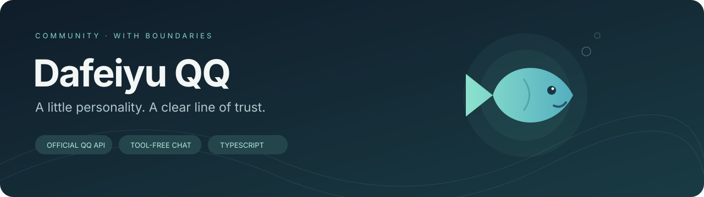
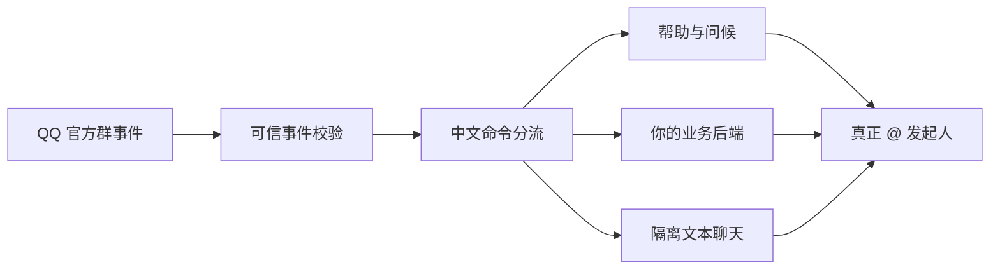

<div align="center">



# 大肥鱼 · Dafeiyu QQ

**让群聊有回应，让业务有边界。**

基于 QQ 官方接口与 DSH 的社区机器人适配器。中文自然指令、独立业务接口、无工具聊天。

[](https://github.com/Piloting06/dafeiyu-qq/actions/workflows/ci.yml)
[](LICENSE)
[](package.json)
[](tsconfig.json)

[快速开始](docs/getting-started.md) · [架构](docs/architecture.md) · [后端契约](docs/backend-contract.md) · [安全边界](docs/security.md) · [参与贡献](CONTRIBUTING.md)

</div>

## 一眼看懂

```text
@大肥鱼 帮助        → 简洁的操作入口
@大肥鱼 签到 42     → 显式业务回调；首次可带站内 ID
@大肥鱼 领取42      → 中文指令不强制空格
@大肥鱼 余额        → 本人主动查询，群内显示
@大肥鱼 今天辛苦啦  → 轻松聊两句，聊天没有账户操作能力
```

回复会真正 @ 发起人。首次缺 ID 时，收到提示后可以立即补发；领取和签到分别处理。

> 这是从实际社区集成中整理的**独立公开适配层**。提供可运行的离线演示、SDK中间件、DSH适配脚本与
> 业务后端契约；完整网站控制台、真实余额账本和生产部署系统由你的业务平台提供。开源版不携带任何
> 真实运营数据，也不把演示积分当成真钱。

## 能力

| | 提供的能力 |
| --- | --- |
| 🐟 群内交互 | 官方群 @、中文指令、早午晚安与北京时间错时问候、可信发送者提及 |
| 🎁 业务集成 | 领取、签到、本人余额、群审批的受限后端接口；策略与功能独立开关 |
| 💤 节奏控制 | 北京时间休息时段、有界排队、个人冷却、事件时效、一次补 ID 机会 |
| 🛡️ 执行边界 | 聊天无工具、无文件/进程执行；公开消息不进入宿主 Agent |
| 🔎 工程质量 | 严格 TypeScript、真实 SDK 合成事件测试、源码基线校验、可复现构建与 CI |

## 60 秒体验

Node.js 24.22.3，无需 QQ、模型 Key 或业务服务器：

```sh
git clone https://github.com/Piloting06/dafeiyu-qq.git
cd dafeiyu-qq
npm ci --ignore-scripts --no-audit --no-fund
npm run demo
npm run check
```

演示依次走过：**帮助 → 缺 ID → 立即补填 → 活动去重 → 签到 → 同日去重 → 本人余额**。
全程合成消息、内存积分，既不联网发奖，也不登录真实 QQ。

## 接入路线



- **已有 SDK 宿主**：组合导出的中间件，显式注入策略、业务与文本回调。
- **已有 DSH**：通过精确基线的源码适配脚本，把中间件放在宿主公开消息处理之前。
- **接自己的余额系统**：实现五条固定能力接口，由后端保证认证、绑定、预算和持久化幂等。

完整步骤见 [接入指南](docs/getting-started.md)。默认关闭业务能力；QQ 官方应用仍需自行申请授权及权限。
使用官方接口不代表平台保证不会限制应用，聊天模型调用也可能产生费用。

## 文档导航

| 文档 | 内容 |
| --- | --- |
| [安装与接入](docs/getting-started.md) | 离线演示、SDK组合、DSH源码适配与真实验收 |
| [配置参考](docs/configuration.md) | 环境变量、网站白名单、策略与北京时间 |
| [架构](docs/architecture.md) | 模块职责、消息链路与两种接入方式 |
| [业务契约](docs/backend-contract.md) | 请求响应、幂等、预算、绑定及人工补发边界 |
| [安全](docs/security.md) | 信任边界、威胁与已知限制 |
| [决策记录](docs/adr/0001-separate-chat-and-actions.md) | 为什么把聊天和业务动作隔离 |

## English

Dafeiyu QQ is a TypeScript community-bot adapter for the official QQ platform and DSH.
It combines deterministic Chinese commands, sender-specific mentions, quiet hours,
bounded queues and a tool-free text-chat boundary. Business operations use an explicit
capability client; your backend owns authentication, account binding, budget checks
and durable idempotency. The offline demo uses synthetic SDK events and in-memory points.
This repository does not include a production ledger or the original private dashboard.

## License & credits

[AGPL-3.0-only](LICENSE)。许可归属与改动说明见 [NOTICE](NOTICE)。本项目保留 `new-api / QuantumNous`
归属；腾讯 QQ SDK、DSH QQ 插件与 DeepSeek Harness 由各自项目维护，按各自许可单独安装。
大肥鱼是独立社区项目，与这些厂商没有官方隶属关系。本次公开整理包含 AI 辅助贡献。
