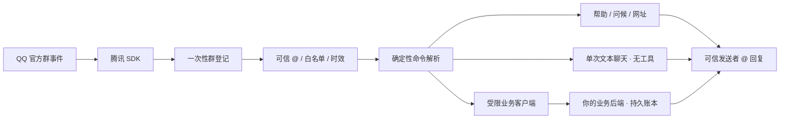

# 架构

| 模块 | 责任 |
| --- | --- |
| `src/adapter.ts` | 事件校验、中文指令、排队、冷却、休息时段与回复分流 |
| `src/enrollment.ts` | 复用 DSH 的限时配对服务，一码仅登记一个群 |
| `src/preview.ts` | 本地关闭策略 / 业务后端模式；无后端时不注入资金执行器 |
| `src/hub.ts` | 五条固定能力接口、令牌文件、截止时间、大小限制、不跟随重定向 |
| `src/text-chat.ts` | DSH 文本流接入；不创建宿主 Agent |
| `src/replies.ts` | 可信 @、文字转义、输出约束 |
| `src/join.ts` | 有权限时单次尝试批准；有风险或未知结果留人工 |
| `prepare-source.mjs` | 校验精确公开上游基线后修改可丢弃源码副本 |
| `slot-bridge.mjs` | 可选的回环活动槽桥接 |

## 两种接入

1. **直接组合中间件**：显式传 `policy / execute / chat`，适合自己的 SDK 宿主；参见 `examples/demo.ts`。
2. **DSH 插件源码适配**：精确版本的 DSH QQ 插件，通过准备脚本插入入口；参见 [接入指南](getting-started.md)。

普通群消息在业务中间件终止，不传给后续宿主命令和工具。群登记仅扩大候选群列表，业务白名单
仍需独立确认。聊天、活动、签到、余额、审批分别控制；静默时段采用北京时间，默认示例为关闭。

公开协议标识为 `dafeiyu.qq-official.v1`，配置前缀为 `DAFEIYU_`。如已有私有部署，不能直接用此
公开版覆盖，必须显式适配契约和配置名称后独立验收。
